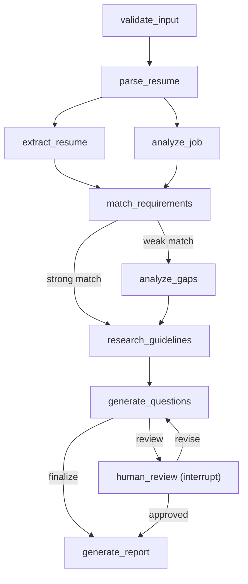

# Resume Screening (LangGraph)

Screens a resume against a job description with a LangGraph workflow on Gemini:
it extracts structured data, matches skills, analyses gaps, looks up company interview
guidelines (Qdrant vector search), drafts interview questions, then pauses for human
approval before producing a JSON report.



Each review is recorded (who, what, when) in the screening and its report. After `MAX_REVISIONS`
revisions the last feedback is still applied: the questions are regenerated with it, then the report
is written without another review (`approved_by_human: false`). The API's `revisions_remaining`
field, the UI and the CLI say beforehand when a revision is the last one. With `MAX_REVISIONS=0` the
reviewer can only approve (a revision is refused with `400`).

Skill matching is deterministic code (`app/graph/matching.py`). Names are normalized before they are
compared: aliases ("Postgres" is PostgreSQL), versions ("Python 3.11"), `.js` suffixes ("React.js") and
vendor prefixes ("Amazon S3", "Apache Kafka"). A required category is met by any of its tools ("CI/CD"
by Jenkins, "SQL" by PostgreSQL), but one tool never meets another ("Jenkins" is not met by GitHub
Actions). A grouped requirement such as "AWS (EC2, S3)" needs AWS itself or every listed part. A job
description with no required skills is rejected rather than scored as a 100% match.

LLM steps get a second attempt (`LLM_NODE_ATTEMPTS`) when a reply does not parse or the provider
still fails after the client's own retries. With `GEMINI_FALLBACK_MODEL` set, a call the main model
still fails goes to that model instead. A screening that fails anyway keeps its completed steps:
`continue` runs the failed step again. Company guidelines are looked up once, in their own step, so a
retried or revised question step reuses them instead of repeating the search (several LLM and
embedding calls).

The model and prompts are scored against labelled cases in `evals/` (see `evals/README.md`):
extraction precision and recall, experience, the route each screening takes, resistance to a prompt
injection in the resume, counterfactual fairness pairs and, optionally, the interview questions.

## LLM call flow

Each workflow node that calls the LLM uses one of two patterns from `app/core/llm.py`:

```mermaid
flowchart TD
    A["HTTP POST /screenings"] --> B["LangGraph workflow"]
    B --> C["extract_resume<br/>structured_call(ResumeProfile)"]
    B --> D["analyze_job<br/>structured_call(JobRequirements)"]
    C --> E["match_requirements<br/>(deterministic, no LLM)"]
    D --> E
    E -- strong match --> G
    E -- weak match --> F["analyze_gaps<br/>structured_call(GapAnalysis)"]
    F --> G["research_guidelines<br/>(vector search only, no LLM)"]
    G --> H["generate_questions"]
    H --> H1["gather_guidelines&#58;<br/>get_tool_llm with lookup_interview_guideline<br/>searches Qdrant, summarises results"]
    H1 --> H2["structured_call(InterviewQuestionSet)"]
    H2 --> I["human_review<br/>(interrupt, no LLM)"]
    I --> J["generate_report<br/>structured_call(ScreeningReport)"]
```



`structured_call` — one prompt in, one typed object back (uses `get_structured_llm`).
`get_tool_llm` — model drives a search loop, calling tools until it has enough context.
Both go through `with_fallback`: primary model first, then `GEMINI_FALLBACK_MODEL` (if set) only when the primary exhausts all retries.

## Setup

```bash
# With uv (https://docs.astral.sh/uv/), exactly what CI tests: the hash-locked dev lockfile
uv venv -p 3.12 && source .venv/bin/activate
uv pip sync --require-hashes requirements/dev.txt && uv pip install --no-deps -e .
# Or with pip: python -m venv .venv && source .venv/bin/activate && pip install -e ".[dev]"
cp .env.example .env          # then set GEMINI_API_KEY, and API_KEY (or ALLOW_OPEN_API=true for local use)
```

## Run

```bash
uvicorn app.api:app --reload              # API on :8000, docs at /docs (without API keys; see API_DOCS)
streamlit run ui/streamlit_app.py         # UI
resume-screener start data/resumes/resume.pdf data/jds/jd.txt   # CLI (or python -m app.cli); prints the screening id
resume-screener review <id>                                       # approve or revise; a completed one is saved to reports/
resume-screener continue <id>                                     # resume a run that paused, stopped part-way or failed
resume-screener delete <id>                                       # erase a screening and its data
resume-screener purge [--days N]                                  # erase screenings idle over N days
resume-screener-ingest                    # rebuild the guideline index (stop the API first in local Qdrant mode)
```

## Live progress

`POST /screenings`, `/screenings/{id}/review` and `/screenings/{id}/continue` accept `?stream=true`.
The response is then NDJSON (one JSON object per line), produced from LangGraph's
`stream(stream_mode="tasks")` while the graph runs:

```
{"type": "step", "thread_id": "3f9a…", "node": "extract_resume", "event": "started"}
{"type": "step", "thread_id": "3f9a…", "node": "extract_resume", "event": "finished"}
...
{"type": "step", "thread_id": "3f9a…", "node": "human_review", "event": "interrupted"}   # paused for review
{"type": "result", "screening": {...}}                              # same body as without stream
```

Input errors are rejected with a normal status code before streaming starts; a failure after that
arrives as a final `{"type": "error", "status": 500, "detail": ...}` event. The Streamlit UI uses this
to show each step as it runs. Without `?stream`, the same run returns one JSON response.

Every step event carries the `thread_id`, so a client whose stream drops can `GET /screenings/{id}`.
While a request is still executing the screening, that returns `"status": "running"`; the UI does this
automatically and offers a Refresh button. A run that was cut off part-way (the client went away or the
server restarted) shows `"status": "stopped"`, unlike `"paused"` at a breakpoint you chose, and one where a
step raised an error shows `"failed"`. `POST /screenings/{id}/continue` resumes any of them from the last
completed step. `GET /screenings?limit=N` lists the caller's screenings, newest first, so a lost id can be
found again; the UI shows them under "My recent screenings".

## API protection

Configured in `.env` (see `.env.example`):

- **API keys**: set `API_KEYS` to comma-separated `name:key` pairs (one per client or person), or
  `API_KEY` for a single key named `default`. Every `/screenings` request must send one as the
  `X-API-Key` header (`401` otherwise; compared in constant time, and a wrong key counts against its
  address's rate limit, so guesses are throttled). Both checks run in middleware *before the request body is read*: FastAPI parses
  uploads before it runs dependencies, so an unauthenticated client could otherwise make the server read
  a full upload. With no key set the API refuses to start, unless `ALLOW_OPEN_API=true` (no
  authentication, for local development only; it then logs a warning). The Streamlit UI sends
  `API_KEY` from its own environment. `/health` never needs a key.
- **Key storage, expiry and rotation**: a key in `API_KEYS` may be stored as its SHA-256
  (`name:sha256:<hex>`, from `python -c "import hashlib,getpass; print(hashlib.sha256(getpass.getpass().encode()).hexdigest())"`),
  so the server's configuration never holds a usable key. `API_KEY_EXPIRES=name:YYYY-MM-DD,...` sets
  the last day (UTC) each key works; after it the key gets `401`. To rotate, add the next key under a
  new name, move the client to it, then remove (or let expire) the old one. Unknown names in either
  setting stop the API at startup, so a typo cannot leave a key without its expiry.
- **Roles**: a normal key starts, reviews and deletes its own screenings. The keys named in
  `AUDIT_KEYS` are read-only (`403` for anything but `GET`, checked before the body is read) and see
  every screening, for audits and data-subject requests; the request log records which audit key read
  what. An audit key can never act for a person.
- **Ownership**: a screening belongs to the caller that started it. Other callers get `404` for it, as if
  it did not exist. A client acting for several people (the UI) names the person in the `X-Acting-User`
  header; the caller is then `key/person`, so each person sees only their own screenings, and the key
  vouches for the name. Only the keys named in `ACTING_USER_KEYS` (default `default`, the `API_KEY`;
  e.g. `ui` with `API_KEYS=ui:...`) may send it; any other key gets `403`, so a key handed to one
  person or script cannot pose as someone else. The UI's key can still name anyone: guard it. Screenings started from the CLI, or while no keys were configured, have no owner:
  only the CLI (or an API without keys) sees them, so turning keys on never exposes them to every key.
- **Review audit trail**: each review records the key's name (`client`) and the person (`reviewer`):
  the `X-Acting-User`, else the `reviewer` field of the request (a name the client gives, such as the one
  typed at the UI's shared login), else the key's name. A person authenticated through `X-Acting-User`
  cannot record a review under another name. Each review also records `reviewer_verified`: `true`
  when a key vouched for the name, `false` for a name the client only claims (the shared login). `reviewer` allows letters, digits, spaces and `. , ' @ -`
  only, so it cannot forge log lines. The report has the full list in `reviews` and the approver in
  `approved_by`.
- **UI login**: because the UI sends the API key for whoever uses it, set `UI_USERS` (`name:password`
  pairs, one login per reviewer, each seeing only their own screenings) or `UI_PASSWORD` (one shared
  login; reviewers type their name, and the team shares its screenings). The signed-in name is recorded
  on each review. Passwords may be scrypt hashes (`python ui/login.py hash`) and are compared in constant
  time. After 5 failed sign-ins in 5 minutes, that client address is locked out for the rest of the
  window, across all of its browser sessions; behind the compose proxy the address comes from its
  `X-Forwarded-For` (`UI_BEHIND_PROXY`). With `UI_REQUIRE_LOGIN=true` (compose sets it) and neither login
  configured, the page refuses to serve rather than run open. Plain-text passwords work for local
  development only (with a warning at startup); `UI_REQUIRE_LOGIN=true` refuses them. Single-quote a
  hash in `.env` (`UI_PASSWORD='scrypt$...'`): docker compose expands unquoted `$` parts, and a damaged
  hash is refused rather than compared as plain text. A session left unused for
  `UI_SESSION_TIMEOUT_MINUTES` (default 30) is signed out. Untrusted text (resume, JD,
  LLM output) is Markdown-escaped before the UI renders it, so a crafted resume cannot inject links or
  images into the reviewer's browser.
- **API docs**: `/docs`, `/redoc` and `/openapi.json` are served only while no API key is configured
  (local development), unless `API_DOCS=true`.
- **Rate limits**, in two budgets a request must both fit. Per person: `RATE_LIMIT_PER_MINUTE`
  (default 60) for any `/screenings` request, plus `WORKFLOW_RATE_LIMIT_PER_MINUTE` (default 5) for the
  requests that run LLM calls (start, review, continue). A person is the caller (`key` or `key/person`);
  a key with no acting user may name a browser session in `X-Client-Session`, which the UI's shared
  login does, so each session gets its own budget; without a valid key it is the client IP. Per key,
  all its people and sessions together: `KEY_RATE_LIMIT_PER_MINUTE` (600) and
  `KEY_WORKFLOW_RATE_LIMIT_PER_MINUTE` (30). Person and session names are chosen by the client, so this
  ceiling is what stops a key holder from rotating them for unlimited LLM spend. Over a limit returns
  `429` with `Retry-After`, and a refused request uses up neither budget. All of these run in the
  middleware, so a client over its workflow limit gets the `429` before its upload is read. `/health`
  and `/ready` are exempt. Counts are in memory per worker process. Behind a reverse proxy, set `FORWARDED_ALLOW_IPS` to the
  proxy's address so limits apply to real client IPs (compose does).
- **Daily spend ceilings**: `KEY_DAILY_WORKFLOW_LIMIT` (default 500) workflow requests per key in
  any 24 hours (`429`), and `DAILY_TOKEN_BUDGET` (default 5,000,000) LLM tokens server-wide, after
  which new runs get `503` with `Retry-After` until older usage ages out. Runs already going finish,
  so the budget can be overshot by what they use. `0` turns either off. Both are in memory and reset
  on restart, like the rate limits.
- **Concurrent runs**: at most `MAX_CONCURRENT_RUNS` (default 8) workflow runs at once, server-wide. Each
  holds a worker thread for minutes of LLM calls; a run over the cap gets `503` with `Retry-After`, so
  reads and `/health` (served on the event loop) keep answering. A streamed request (`?stream=true`)
  is refused the same way, before streaming starts, and a refused start stores nothing (no upload).
- **CORS**: `CORS_ORIGINS` is a comma-separated list of browser origins. It is empty by default, so no
  cross-origin browser access. The Streamlit UI calls the API server-side and needs no entry.
- **Request size**: bodies over twice `MAX_UPLOAD_MB` are rejected with `413`, from `Content-Length` up front
  or, for chunked uploads, by counting bytes as they arrive (reading stops at the limit). Resume or
  JD text over `MAX_DOCUMENT_CHARS` (default 50,000) with `400`, so no input can flood the LLM context.
- **Untrusted PDFs**: text is extracted in a child process with a 1 GB memory cap, killed after
  `PDF_TIMEOUT_SECONDS` (default 30), so a crafted PDF costs one short-lived process, not a worker
  thread. Anything the PDF reader raises is a `400` (unreadable PDF), not a server error. A JD PDF is
  only read once the run holds a slot, so it counts against `MAX_CONCURRENT_RUNS` too.
- **One request per screening at a time**: a review, continue or delete that arrives while the same screening
  is still running gets `409`, so a double-clicked review cannot resume it twice.
- `thread_id` path values are validated, and responses carry security headers (including HSTS, which
  browsers apply over the compose proxy's TLS). Clients get the report itself in `final_report`.

## Data privacy

Resumes are personal data, so the app keeps as little as it can, for as short a time as it can:

- **Erasure on request**: `DELETE /screenings/{id}` (or `resume-screener delete <id>`, or the UI's
  delete button) removes the workflow state with the resume text, the report and any uploads.
- **Retention**: screenings idle for `RETENTION_DAYS` (default 30) are erased automatically; the API
  checks every `PURGE_INTERVAL_MINUTES`. `resume-screener purge [--days N]` does the same on demand.
  `RETENTION_DAYS=0` keeps everything and logs a warning.
- **Minimisation**: the resume PDF is deleted as soon as its text is extracted, and a JD PDF is read in
  memory and never written to disk. Input rejected part-way (an unreadable PDF, a JD with no required
  skills) erases the screening. The report stays in the screening's state: the API never copies it to a
  file; only the CLI writes one, when it shows a completed screening.
- **At rest**: the checkpoint DB, uploads and reports are owner-only (`0600` files, `0700` directories).
  Report files are named `<screening id>.json`, with no candidate name. Erasing a screening zeroes
  its rows (`secure_delete`) and then checkpoints and truncates SQLite's write-ahead log, which would
  otherwise keep copies of the erased pages in `checkpoints.db-wal`.
- **Third parties**: resume and JD text, and the data extracted from them, are sent to the Google
  Gemini API for extraction, gap analysis and question generation (and to LangSmith, if tracing is
  turned on). Check that your Gemini terms cover personal data before screening real candidates: on
  the free tier, Google may use prompts to improve its products, and candidates may need to be told
  their data is processed this way.
- **Backups** (`scripts/backup.sh`, see Docker) hold resume text too: they are encrypted with
  [age](https://age-encryption.org) to `BACKUP_AGE_RECIPIENT` (a public key, so the server cannot read
  them back), `0600`, and the script deletes those older than `KEEP_DAYS` (default 30). Deleting a
  screening or the retention purge cannot reach backups: a deleted screening is fully gone only once
  the backups taken before its deletion have expired, so keep `KEEP_DAYS` within your retention promise.
- **Skills the resume never mentions**: a skill the LLM extracts but the resume text does not contain
  under any known spelling is listed in `unverified_skills` and left out of the match, so an invented
  skill cannot raise the score. The reviewer sees the list and can add a skill back at the
  `match_requirements` breakpoint.
- **Developer and test machines**: a local run keeps resume text in `checkpoints.db`, `data/uploads/`
  and `reports/`. Test with the synthetic resumes in `data/resumes/` only, and run
  `scripts/wipe_local_data.sh` (with the API stopped) when you are done. See [SECURITY.md](SECURITY.md).
- **Logs** hold screening ids, never resume content: a failed run logs the error type and stack frames
  only (exception messages can quote LLM output), and the full messages only at `LOG_LEVEL=DEBUG`.
- Responses carry `Cache-Control: no-store`. Uploaded text reaches the LLM inside `<document>` tags,
  with instructions to treat it as data, to blunt prompt injection from a crafted resume. The later prompts
  (gap analysis, guideline research, questions) get the same rule for values extracted from the uploads.
  Reviewer feedback goes in a separate `reviewer_feedback` key of the input JSON, never in the system
  prompt. Uploaded text only ever appears inside JSON string values, so it cannot pose as that key.

## Logs and run metrics

- Every API request gets an id: it is returned as `X-Request-ID`, added to every log line the request
  causes, and logged on one summary line (method, path, status, time, caller), which doubles as the
  audit trail of who read or deleted what. A client may send its own `X-Request-ID` to correlate with
  its logs.
- Each workflow run logs one line with its outcome, wall time, time per node and LLM token counts.
- `GET /health` is liveness (the process answers); `GET /ready` is readiness: `503` unless the
  checkpoint database answers, and it reports the guideline store (Qdrant) too, without failing on
  it, since screenings run without guidelines. Neither needs a key; `/ready` says what is down, never
  why (that is logged). The compose healthcheck uses `/ready`.
- `GET /metrics` serves Prometheus metrics: requests by status (including unhandled `500`s), a
  request latency histogram, runs by outcome, run time, runs in progress and LLM tokens. Like `/health` it needs no key, so keep it internal: the compose proxy
  does not route it. `METRICS_ENABLED=false` turns it off.
- `LOG_FORMAT=json` writes one JSON object per line, for log collectors.

## Monitoring

Optional Prometheus + Grafana, reading `/metrics` (above):

```bash
# GRAFANA_ADMIN_PASSWORD must be set in .env (see .env.example)
docker compose -f docker-compose.yml -f docker-compose.monitoring.yml up -d
```

Grafana (`http://localhost:3000`, user `admin`) comes up with a provisioned "Resume screener"
dashboard (requests by status, latency, runs by outcome, run time, runs in progress, LLM tokens) and
a Prometheus datasource, both read-only in the UI: edit `deploy/grafana/dashboards/resume-screener.json`
and redeploy to change them. Prometheus (`deploy/prometheus/`) scrapes `api:8000/metrics` every 15s
and evaluates the alert rules in `deploy/prometheus/alerts.yml` (API down, high 5xx rate, repeated
run failures, run slots saturated, daily token budget nearly spent) — visible at Prometheus's own
`/alerts`, and in Grafana's alert list, but nothing is wired to notify anyone yet: add an Alertmanager
service with a receiver (email, Slack, PagerDuty) for that. Grafana listens on `127.0.0.1:3000` only
(tunnel in from elsewhere: `ssh -L 3000:localhost:3000 <server>`); neither service is routed by the
proxy or reachable from the internet. CI starts this overlay too and checks the API target is up and
the dashboard is provisioned.

## Docker

```bash
cp .env.example .env          # then set GEMINI_API_KEY, API_KEY, QDRANT_API_KEY and UI_USERS or UI_PASSWORD
                              # (passwords as single-quoted scrypt hashes: python ui/login.py hash)
docker compose up --build     # https://localhost/ (UI) and https://localhost/api/ (API)
```

Only the Caddy proxy (`deploy/Caddyfile`) is published, on ports 80 and 443: it serves the UI at `/`
and the API at `/api/` over HTTPS, so the API key, passwords and resume data never cross the network
in plain text. With `SITE_ADDRESS=localhost` it uses its own local CA (the browser warns until it is
trusted); set `SITE_ADDRESS` to a domain pointing at the host for a Let's Encrypt certificate. The API
and UI containers are reachable only on the compose network, and each service has CPU and memory limits.

Every container runs with all Linux capabilities dropped (the proxy keeps only the one to bind ports
80 and 443) and `no-new-privileges`; the proxy, API and UI also have read-only root filesystems, with
state in volumes and scratch space in `/tmp`. Qdrant requires `QDRANT_API_KEY` even on the compose
network. The API trusts `X-Forwarded-For` only from the proxy's fixed address (`PROXY_IP`, default
`172.30.240.10`, in `COMPOSE_SUBNET`, default `172.30.240.0/24`; set both in `.env` if they clash with
a host network). The API container gets `.env` minus the UI's logins, which only the UI needs.

Secrets can be files instead of environment variables, which show in `docker inspect`: the API reads
any setting from `/run/secrets/<name>` (e.g. `/run/secrets/gemini_api_key`, where Docker secrets are
mounted) when it is not in the environment, and the UI reads `API_KEY_FILE`. `scripts/fetch_secrets.sh`
populates that directory from AWS Secrets Manager, GCP Secret Manager or Vault; see
[docs/operations.md](docs/operations.md#secrets).

**Backups**: `BACKUP_AGE_RECIPIENT=age1... scripts/backup.sh [dir]` copies the checkpoint database
(every screening and the registry) out of the running stack with SQLite's online backup, encrypted
with age, e.g. nightly from cron. Keep the private key (`age-keygen`) off the server.
`AGE_IDENTITY=<key file> scripts/restore.sh <backup>` restores one: it checks the file's integrity
before it touches the live database, then restarts the API. CI backs up and restores on every run,
and checks that a damaged backup is refused. The Qdrant index needs no backup: it is rebuilt from
`data/knowledge_base/`. Recovery objectives and runbooks: [docs/operations.md](docs/operations.md).

**Deploying the published images**: `docker compose up --build` builds from source on the server.
To run the images CI published instead, which are scanned and then signed:

```bash
GITHUB_REPOSITORY=<owner>/<repo> scripts/deploy.sh \
  ghcr.io/<owner>/<repo>-api@sha256:<digest> ghcr.io/<owner>/<repo>-ui@sha256:<digest>
```

It checks each image's cosign signature against this repository's CI on `main` (needs `cosign`), and
refuses tags and anything unsigned, then starts the stack with `docker-compose.prod.yml`.

One `Dockerfile` builds two images: `--target api` (FastAPI, runs as a non-root user) and
`--target ui` (Streamlit only, no LLM dependencies). In Compose the API uses the Qdrant service
instead of local mode, and keeps checkpoints, reports and uploads in the `screener-data` volume.
Compose pins those storage paths, so the host paths in `.env` do not apply inside the container
(with plain `docker run --env-file .env`, leave them out of that file). Qdrant is not published to
the host; only the API reaches it, over the compose network, once its healthcheck passes. The guideline
index is built on the first search. To rebuild it: `docker compose exec api python -m app.knowledge.ingest`.

Builds are reproducible: images install hash-pinned lockfiles (`requirements/*.txt`, generated from
`pyproject.toml` by `scripts/lock.sh`; rerun it after changing dependencies) on a base image pinned by
digest.

The API runs one worker process: the SQLite checkpointer, the per-screening lock and the rate limits
live in that process. Scaling out needs a shared checkpointer (LangGraph's Postgres saver) and a shared
store for those (e.g. Redis).

## Test and quality checks

```bash
pytest --cov                            # tests + coverage
ruff check . && ruff format --check .   # lint (incl. bandit security rules) + formatting
mypy                                    # type checking, with the pydantic plugin
semgrep --test semgrep/ && semgrep scan --config semgrep/ --error app ui evals   # project rules
pre-commit install                      # run all of the above on staged files at each commit
```

Tests need no API key or network: the LLM and vector store are never called.
`tests/test_workflow.py` runs the real compiled graph and SQLite checkpointer end to end with a fake LLM.
CI (`.github/workflows/ci.yml`), with every action pinned by commit SHA:

- lint, type checks and tests (coverage must stay at 80% or more) on Python 3.10 and 3.12, installed from the lockfile;
- gitleaks over the whole git history and the Semgrep project rules in `semgrep/rules.yaml` (settings
  only via `get_settings()`, LLMs only via `app/core/llm.py`, uploads fenced with `as_document`, no
  secrets or resume text in logs);
- `pip-audit` of the lockfiles and a Trivy scan of both images (fixable HIGH/CRITICAL issues fail the build;
  accepted ones are listed with reasons and an expiry in `.trivyignore`), also weekly for new advisories;
- builds both images and smoke-tests each one's health endpoint;
- starts the whole compose stack (proxy, hardened containers, Qdrant) and checks routing and protection
  through the proxy: `401` without a key, `/api/metrics` not routed, UI headers, HTTP→HTTPS; then
  backs the database up and restores it (the recovery drill), and checks a damaged backup is refused;
- on `main`, publishes both images to GHCR (with SBOM and provenance) under their commit tag, scans
  the pushed image by digest, signs it with cosign (keyless) and only then tags it `latest`, so what
  is deployed is exactly what was scanned. An image that fails its scan is deleted again, and
  `scripts/deploy.sh` would refuse it anyway, being unsigned;
- on manual dispatch with `live_eval`, runs the evals (with the question rubric) against the real Gemini
  API, in the `eval` GitHub environment with its own `GEMINI_EVAL_API_KEY`: a key from a separate,
  quota-capped project, never the production one.

Dependabot proposes updates for the pinned actions and base image.

## Layout

| Path | Role |
|------|------|
| `pyproject.toml` | Package metadata, dependencies, entry points, pytest, coverage, ruff and mypy config |
| `requirements/`, `scripts/lock.sh` | Hash-pinned lockfiles (API image, UI image, dev/CI) and the script that generates them |
| `Dockerfile`, `docker-compose.yml`, `deploy/Caddyfile` | API and UI images; full stack with Qdrant behind a TLS proxy |
| `docker-compose.prod.yml`, `scripts/deploy.sh`, `scripts/backup.sh`, `scripts/restore.sh` | Run the signed published images (signatures checked first); back up and restore the checkpoint DB |
| `scripts/fetch_secrets.sh` | Populate `/run/secrets/` from AWS Secrets Manager, GCP Secret Manager or Vault |
| `scripts/wipe_local_data.sh` | Erase the personal data a local run leaves on a developer or test machine |
| `SECURITY.md`, `docs/` | Vulnerability reporting and machine practices; operations (recovery objectives, runbooks, environments), threat model, compliance |
| `evals/` | Labelled cases and the scorer for the LLM steps (`python -m evals.run_eval`) |
| `.pre-commit-config.yaml`, `.github/` | Commit hooks, CI and Dependabot |
| `semgrep/`, `.gitleaks.toml` | Project Semgrep rules (with their tests) and the gitleaks allowlist |
| `docker-compose.monitoring.yml`, `deploy/prometheus/`, `deploy/grafana/` | Optional Prometheus + Grafana overlay |
| `app/cli.py` | Command-line runner (`resume-screener`) |
| `app/core/` | Settings (`config.py`, from env/.env), logging, metrics, LLM prompts and the lazily created chat model with its optional fallback (`llm.py`) |
| `app/graph/` | State, nodes, routing, the compiled graph and `runner.py`, which executes it; `matching.py` (skill and experience scoring) holds the logic the nodes use |
| `app/schemas/` | Resume, job and analysis models the LLM fills (structured output); HTTP request/response models are in `app/api/schemas.py` |
| `app/knowledge/`, `app/tools/` | Qdrant guideline store; `tools/` holds the LLM tool that searches it (`knowledge_tools.py`) and the tool-calling loop that drives it (`guidelines.py`, run by the `research_guidelines` step) |
| `app/utils/` | Small helpers with no LLM: PDF text extraction, safe report filenames |
| `app/repositories/` | Stored state: the checkpointer, the app's `screenings` table (ownership, creation time, listing summary), uploads and exported reports. Gets the compiled graph passed in |
| `app/services/` | Business logic, no HTTP: `screening_service.py` (operations and `create_service()` wiring), `concurrency.py` (per-screening lock, run slots, `HeldRun`), `inputs.py` (upload, JD, breakpoint and skill-correction checks), `token_budget.py`, `views.py` (state → client view), `run_stats.py` (per-run cost line and metrics) |
| `app/api/` | FastAPI app factory, routes, request/response schemas, API key auth and rate limiting |
| `ui/` | Streamlit client of the API: `streamlit_app.py` (pages), `api_client.py` (HTTP calls), `login.py` (sign-in) |
